# 🌐 Awesome Web Frameworks & Modern Web App Platforms

  <strong>A curated list of modern full-stack web frameworks, meta-frameworks, static site generators, and edge-native hosting platforms.</strong>

  
  
  
  
  
  
  

---

## 📑 Table of Contents

- [🔍 SEO & Overview Summary](#-seo--overview-summary)
- [📊 Sector Overview & Market Dynamics](#-sector-overview--market-dynamics)
- [☁️ SaaS Products & Cloud Platforms](#️-saas-products--cloud-platforms)
- [🚀 Open-Source Web Frameworks (Ranked by Stars)](#-open-source-web-frameworks-ranked-by-stars)
  - [⚡ Meta-Frameworks & Full-Stack](#-meta-frameworks--full-stack)
  - [📄 Static Site Generators (SSG) & Content Engines](#-static-site-generators-ssg--content-engines)
  - [🏎️ High-Performance Backend & Edge APIs](#️-high-performance-backend--edge-apis)
  - [🏛️ Classical Enterprise & Battery-Included Frameworks](#️-classical-enterprise--battery-included-frameworks)
- [🎯 Framework Selection Decision Matrix](#-framework-selection-decision-matrix)
- [🤝 How to Contribute](#-how-to-contribute)
- [💖 Support & Community](#-support--community)
- [📈 Star History](#--star-history)
- [⚖️ Disclaimer & License](#️-disclaimer--license)

---

## 🔍 SEO & Overview Summary

Welcome to the definitive, search-optimized encyclopedia of **Web Frameworks**, **Full-Stack Meta-Frameworks**, **Static Site Generators (SSG)**, and **Cloud Platforms**. Whether you are architecting a high-throughput enterprise SaaS, building an interactive real-time dashboard, or generating a blazing-fast documentation portal, selecting the right web architecture is the highest-leverage engineering decision you will make.

### 🏷️ Search Keywords
`web frameworks`, `fullstack frameworks`, `nextjs`, `react`, `vue`, `sveltekit`, `astro`, `nuxt`, `django`, `fastapi`, `spring boot`, `laravel`, `express`, `hono`, `fastify`, `static site generator`, `ssg`, `ssr`, `islands architecture`, `serverless web apps`, `edge computing`, `jamstack`, `web development`.

---

## 📊 Sector Overview & Market Dynamics

The global web application infrastructure, hosting, and developer platform (PaaS / Composable Web) market is currently valued between **$140 billion and $180 billion**, expanding rapidly at a compound annual growth rate (**CAGR of 15% to 20%**) toward an estimated **$250+ billion**.

From a structural perspective, the sector exhibits **moderate fragmentation with an aggressive barbell concentration**:
- **The Infrastructure Bedrock (Hyperscalers & Global CDNs)**: At the base layer, global cloud giants (Amazon Web Services, Microsoft Azure, Google Cloud) and edge networks (Cloudflare) dominate core compute, global CDN routing, and object storage in an oligopolistic fashion.
- **The Developer Experience (DX) Vanguard**: At the application layer, specialized developer-first platforms (Vercel, Netlify, Render, Supabase) command outsized developer adoption and workflow loyalty by tightly coupling framework optimizations (Next.js, Nuxt, Astro, SvelteKit) with zero-configuration CI/CD, instant preview URLs, and serverless edge runtimes. This prevents single-vendor winner-take-all capture while catalyzing fierce ecosystem competition around developer ergonomics.

---

## ☁️ SaaS Products & Cloud Platforms

The following hosted platforms provide managed deployment, automated scaling, serverless edge runtimes, and companion databases for modern web frameworks. 

> *Sorted descending by company valuation / market capitalization.*

| 🏢 Platform & Provider | 📈 Company Size (Valuation / Revenue) | 💳 Starting Tier Price | 🎁 Free Tier Limit / Free Trial Plan | ✨ Core Focus & Ecosystem Strengths |
| :--- | :--- | :--- | :--- | :--- |
| [**AWS Amplify**](https://aws.amazon.com/amplify/)   *(Amazon Web Services)* | **~$2.1 Trillion** market cap   *(AWS: $105B+ ARR)* | **$0.01/build min** + **$0.15/GB** bandwidth *(Pay-as-you-go)* | **12-Month Free Tier**: 1,000 build minutes/month, 15 GB hosted bandwidth/month, 5 GB storage | Direct deep integration with AWS ecosystem (Cognito, DynamoDB, Lambda, S3, CloudFront). |
| [**Cloudflare Pages**](https://pages.cloudflare.com/)   *(Cloudflare, Inc. - NYSE: NET)* | **~$115 Billion** market cap   *($2.2B+ ARR)* | **$5.00 / month**   *(Workers Paid plan)* | **Free Forever**: Unlimited bandwidth, unlimited requests, 500 builds/month, 100,000 Worker requests/day | Ultra-low latency edge deployment with integrated V8 Workers, KV storage, D1 SQL, and R2 object storage. |
| [**Supabase**](https://supabase.com/)   *(Supabase, Inc.)* | **~$10.5 Billion** valuation   *($500M+ funding)* | **$25.00 / month**   *(Pro plan)* | **Free Forever**: 500 MB Postgres database, 50,000 MAUs, 1 GB file storage, 5 GB egress *(pauses after 1 week inactivity)* | The open-source Firebase alternative: instant Postgres backend, Auth, Realtime subscriptions, Edge Functions, and Vector embeddings. |
| [**Vercel**](https://vercel.com/)   *(Vercel, Inc.)* | **~$9.3 Billion** valuation   *($340M–$500M ARR)* | **$20.00 / user / month**   *(Pro plan)* | **Free Forever (Hobby)**: 100 GB fast data transfer/month, 100 GB-hours serverless execution, unlimited personal deployments | Premier platform for Next.js, React Server Components, preview deployments, Edge Middleware, and AI SDK integration. |
| [**Netlify**](https://www.netlify.com/)   *(Netlify, Inc.)* | **~$2.0 Billion** valuation   *($50M+ ARR)* | **$20.00 / month**   *(Pro plan with unlimited seats)* | **Free Forever (Starter)**: 100 GB bandwidth/month, 300 build minutes/month, 500 active Identity users, 100 form submissions/mo | Pioneered the Jamstack model; robust git-based CI/CD, deploy previews, Edge Functions, form processing, and asset handling. |
| [**Render**](https://render.com/)   *(Render Services, Inc.)* | **~$1.5 Billion** valuation   *($258M funding)* | **$7.00 / month** per web service   *($25/mo Pro workspace)* | **Free Forever**: 100 GB static site bandwidth/month, 750 free web service instance hours/month *(spins down after 15 min idle)* | Modern Heroku alternative with zero-friction Docker deploys, background workers, cron jobs, and managed PostgreSQL/Redis. |
| [**Contentful**](https://www.contentful.com/)   *(Contentful GmbH)* | **~$1.3 Billion** valuation   *($219M ARR)* | **$300.00 / month**   *(Basic plan)* | **Free Forever**: 1 space, up to 5 user seats, 25,000 total content records, 2,000,000 API calls/month | Composable Content Platform (Headless CMS) delivering structured omnichannel content via GraphQL & REST APIs. |
| [**Railway**](https://railway.com/)   *(Railway Corp.)* | **~$1.0 Billion** valuation   *($120M+ funding, $20M+ ARR)* | **$5.00 / month** base   *(Hobby plan with $5 credits included)* | **30-Day Free Trial**: $5.00 one-time usage credit, 512 MB RAM limit, 1 GB shared vCPU | Instant infrastructure platform that turns Git repos or Dockerfiles into live services, ephemeral databases, and microservices. |
| [**Sanity**](https://www.sanity.io/)   *(Sanity Operations, Inc.)* | **~$700 Million** valuation   *($173M funding, $40M+ ARR)* | **$15.00 / seat / month**   *(Growth plan)* | **Free Forever**: Up to 20 user seats, 2 public datasets, 500,000 API CDN requests/month, 5 GB asset storage | Structured content operating system featuring real-time collaborative Sanity Studio, GROQ querying, and generative AI workflows. |

---

## 🚀 Open-Source Web Frameworks (Ranked by Stars)

The following open-source frameworks power modern web applications globally. 

> *Sorted descending by exact GitHub stargazer count.*

| 🏆 Rank | 📦 Framework & Repository | ⭐ GitHub_Stars (Live Badge) | 💻 Primary Stack | 🎯 Core Architecture & Highlights |
| :---: | :--- | :---: | :--- | :--- |
| **1** | [**React**](https://github.com/reactjs/react) |  | JavaScript / TypeScript | The foundational component UI library powering Next.js, Remix, Gatsby, and modern full-stack web architectures. |
| **2** | [**Next.js**](https://github.com/vercel/next.js) |  | TypeScript / React | Leading full-stack React framework featuring App Router, React Server Components (RSC), SSR, SSG, and edge runtime support. |
| **3** | [**FastAPI**](https://github.com/fastapi/fastapi) |  | Python | Modern, blazing-fast web framework for building APIs with Python 3.8+ based on standard type hints, Pydantic, and Starlette. |
| **4** | [**Angular**](https://github.com/angular/angular) |  | TypeScript | Google's battery-included enterprise web framework with signals reactivity, hydration, zoneless change detection, and CLI tooling. |
| **5** | [**Django**](https://github.com/django/django) |  | Python | The battle-tested web framework for perfectionists with deadlines; includes ORM, authentication, admin dashboard, and migrations. |
| **6** | [**Hugo**](https://github.com/gohugoio/hugo) |  | Go (Golang) | The world’s fastest static site generator; compiles tens of thousands of pages in milliseconds without external runtime dependencies. |
| **7** | [**Gin**](https://github.com/gin-gonic/gin) |  | Go (Golang) | High-performance HTTP web framework in Go with Martini-like API, custom httprouter tree, middleware support, and minimal memory overhead. |
| **8** | [**Svelte**](https://github.com/sveltejs/svelte) |  | TypeScript / JavaScript | Revolutionary compiler-based UI framework that shifts reactivity to build time, eliminating the virtual DOM overhead. |
| **9** | [**Laravel**](https://github.com/laravel/laravel) |  | PHP | Expressive, elegant full-stack PHP framework featuring Eloquent ORM, Blade templating, Livewire, queue workers, and rich tooling. |
| **10** | [**Vite**](https://github.com/vitejs/vite) |  | TypeScript / Rollup | Next-generation frontend tooling and development server with instant native ESM Hot Module Replacement (HMR) and Rollup bundling. |
| **11** | [**Spring Boot**](https://github.com/spring-projects/spring-boot) |  | Java / Kotlin | Industry standard for Java microservices and enterprise web applications with opinionated auto-configuration and embedded servers. |
| **12** | [**NestJS**](https://github.com/nestjs/nest) |  | TypeScript / Node.js | Progressive Node.js framework building scalable enterprise server-side systems with Angular-inspired modular architecture and dependency injection. |
| **13** | [**Flask**](https://github.com/pallets/flask) |  | Python | Lightweight, extensible WSGI Python micro-framework offering flexibility, simplicity, and a vibrant extension ecosystem. |
| **14** | [**Express**](https://github.com/expressjs/express) |  | JavaScript / Node.js | Fast, unopinionated, minimalist web framework that formed the backbone of the Node.js server-side JavaScript ecosystem. |
| **15** | [**Docusaurus**](https://github.com/facebook/docusaurus) |  | TypeScript / React | Open-source documentation generator from Meta with MDX support, versioning, internationalization, and instant search. |
| **16** | [**Astro**](https://github.com/withastro/astro) |  | TypeScript / Multi-UI | All-in-one web framework for content-driven sites; islands architecture, zero JS by default, and multi-framework component support. |
| **17** | [**Nuxt**](https://github.com/nuxt/nuxt) |  | TypeScript / Vue.js | The intuitive Vue.js meta-framework with hybrid rendering (SSR, SSG, SWR), auto-imports, file-based routing, and Nitro engine. |
| **18** | [**Ruby on Rails**](https://github.com/rails/rails) |  | Ruby | Legendary full-stack framework emphasizing convention over configuration, ActiveRecord ORM, Hotwire/Turbo, and unmatched startup velocity. |
| **19** | [**Gatsby**](https://github.com/gatsbyjs/gatsby) |  | JavaScript / React | React-based static site generator with a unified GraphQL data layer and rich plugin ecosystem for headless CMS data stitching. |
| **20** | [**Vue.js Core**](https://github.com/vuejs/core) |  | TypeScript | Progressive JavaScript framework featuring Composition API, fine-grained reactivity, Single-File Components (SFCs), and lightweight footprint. |
| **21** | [**Jekyll**](https://github.com/jekyll/jekyll) |  | Ruby | Simple, blog-aware static site generator built into GitHub Pages; transforms plain text into static websites using Liquid templates. |
| **22** | [**Fastify**](https://github.com/fastify/fastify) |  | JavaScript / Node.js | Extremely fast, low-overhead Node.js web framework focused on speed, schema validation (JSON Schema), and clean plugin architecture. |
| **23** | [**SolidJS**](https://github.com/solidjs/solid) |  | TypeScript / JSX | Ultra-high performance UI library with fine-grained reactivity, pre-compiled JSX without virtual DOM, and minute bundle footprint. |
| **24** | [**Koa**](https://github.com/koajs/koa) |  | JavaScript / Node.js | Expressive middleware framework created by the Express team utilizing ES2017 async/await functions for robust error handling. |
| **25** | [**Remix**](https://github.com/remix-run/remix) |  | TypeScript / React | Standards-first full-stack React framework focused on nested routing, Web Fetch API, progressive enhancement, and zero-cascade data loading. |
| **26** | [**Hono**](https://github.com/honojs/hono) |  | TypeScript | Ultrafast, lightweight web framework built on Web Standards; runs natively on Cloudflare Workers, Fastly, Deno, Bun, Node, and AWS Lambda. |
| **27** | [**Axum**](https://github.com/tokio-rs/axum) |  | Rust | Ergonomic, modular Rust web application framework built on top of the Tokio async ecosystem, Tower middleware, and Hyper HTTP. |
| **28** | [**Actix Web**](https://github.com/actix/actix-web) |  | Rust | Powerhouse Rust web framework consistently topping TechEmpower benchmarks; provides rock-solid type safety and maximum concurrency. |
| **29** | [**Phoenix**](https://github.com/phoenixframework/phoenix) |  | Elixir / BEAM | Highly concurrent real-time framework on the Erlang VM; features LiveView for reactive, server-rendered UIs with zero client JS required. |
| **30** | [**Qwik**](https://github.com/QwikDev/qwik) |  | TypeScript | Resumable web framework delivering instantaneous sub-second Time-to-Interactive (TTI) by streaming code execution on demand without hydration. |
| **31** | [**SvelteKit**](https://github.com/sveltejs/kit) |  | TypeScript / Svelte | Official full-stack application framework for Svelte; features flexible platform adapters, nested routing, SSR, and tiny client bundles. |
| **32** | [**Eleventy (11ty)**](https://github.com/11ty/eleventy) |  | JavaScript / Node.js | Uncomplicated, framework-agnostic static site generator; processes Markdown, Liquid, Nunjucks, and HTML with zero client JS injection. |
| **33** | [**VitePress**](https://github.com/vuejs/vitepress) |  | TypeScript / Vue.js | High-performance documentation generator built with Vite and Vue 3; superfast dev server and sleek, responsive out-of-the-box theme. |
| **34** | [**Fresh**](https://github.com/freshframework/fresh) |  | TypeScript / Deno | Next-gen edge framework for Deno; features zero build step, JIT compilation, and selective client hydration via islands architecture. |
| **35** | [**SolidStart**](https://github.com/solidjs/solid-start) |  | TypeScript / SolidJS | Full-stack application meta-framework for SolidJS built with Nitro and Vinxi, delivering fine-grained reactivity and minimal payload sizes. |

---

### ⚡ Meta-Frameworks & Full-Stack

Modern meta-frameworks bridge client-side rendering with server-side computation, providing built-in routing, data loaders, server actions, and hybrid rendering strategies:

- [**Next.js**](https://github.com/vercel/next.js) `TypeScript / React` — Industry standard for commercial React web applications with React Server Components, streaming SSR, and image optimization.
- [**Nuxt**](https://github.com/nuxt/nuxt) `TypeScript / Vue.js` — The premier Vue meta-framework offering first-class TypeScript DX, server routes, auto-imported components, and multi-cloud deployment adapters.
- [**Remix**](https://github.com/remix-run/remix) `TypeScript / React` — Leverages native Web Standards (Request, Response, Fetch) and HTML forms with nested layouts and automatic data revalidation.
- [**SvelteKit**](https://github.com/sveltejs/kit) `TypeScript / Svelte` — Streamlined development experience with file-based routing, server load functions, and optimized compiler output.
- [**SolidStart**](https://github.com/solidjs/solid-start) `TypeScript / SolidJS` — Brings Solid's pinpoint reactivity model to the server with Vinxi, Nitro, and modern streaming.
- [**Qwik City**](https://github.com/QwikDev/qwik) `TypeScript / Qwik` — Eliminates client-side hydration via resumability, serializing app state into HTML for instant startup.

---

### 📄 Static Site Generators (SSG) & Content Engines

Optimized for documentation, blogs, marketing portals, and content-centric platforms where performance and SEO are paramount:

- [**Hugo**](https://github.com/gohugoio/hugo) `Go` — Unrivaled build speeds across large catalogs with thousands of pages; single binary execution.
- [**Astro**](https://github.com/withastro/astro) `TypeScript / Islands` — Component islands allow embedding React, Vue, Svelte, or Solid components only where interactivity is required.
- [**Docusaurus**](https://github.com/facebook/docusaurus) `React / MDX` — Documentation engine of choice for major tech ecosystems; versioned docs, localization, and search.
- [**Eleventy (11ty)**](https://github.com/11ty/eleventy) `Node.js` — Lightweight and template-agnostic; ideal for clean, high-performance static sites.
- [**VitePress**](https://github.com/vuejs/vitepress) `Vue / Vite` — The spiritual successor to VuePress; streamlined documentation builder with instantaneous HMR.
- [**Jekyll**](https://github.com/jekyll/jekyll) `Ruby` — The classic static site generator natively supported by GitHub Pages.

---

### 🏎️ High-Performance Backend & Edge APIs

High-concurrency frameworks designed for low-latency microservices, edge routing, and cloud-native backends:

- [**FastAPI**](https://github.com/fastapi/fastapi) `Python` — Declarative, typed API development with automatic OpenAPI/Swagger documentation generation.
- [**Gin**](https://github.com/gin-gonic/gin) `Go` — Lean HTTP web framework with radical performance and minimal memory footprint.
- [**Hono**](https://github.com/honojs/hono) `TypeScript` — Multi-runtime web framework running seamlessly across Cloudflare Workers, Deno, Bun, and Node.js.
- [**Fastify**](https://github.com/fastify/fastify) `Node.js` — High-efficiency Node.js framework capable of handling tens of thousands of requests per second.
- [**Axum**](https://github.com/tokio-rs/axum) `Rust` — Ergonomic, modular routing on top of Tokio with compile-time type safety.
- [**Actix Web**](https://github.com/actix/actix-web) `Rust` — Veteran benchmark leader for extreme throughput and low tail latency.

---

### 🏛️ Classical Enterprise & Battery-Included Frameworks

End-to-end web frameworks that include ORMs, migrations, session authentication, and administrative tooling:

- [**Django**](https://github.com/django/django) `Python` — All-in-one powerhouse with robust security, built-in admin dashboard, and rock-solid ORM.
- [**Laravel**](https://github.com/laravel/laravel) `PHP` — Elegant syntax, rich developer ecosystem (Forge, Vapor, Nova), and modern real-time capabilities with Livewire.
- [**Spring Boot**](https://github.com/spring-projects/spring-boot) `Java` — Foundation of Fortune 500 enterprise architectures, distributed microservices, and robust cloud deployments.
- [**Ruby on Rails**](https://github.com/rails/rails) `Ruby` — The gold standard for developer happiness and rapid startup MVP development.
- [**Phoenix**](https://github.com/phoenixframework/phoenix) `Elixir` — High fault-tolerance and massive concurrency via the Erlang BEAM virtual machine.

---

## 🎯 Framework Selection Decision Matrix

Use the matrix below to match your technical requirements with the optimal framework:

| Architecture Need | Recommended Choices | Key Selection Criteria |
| :--- | :--- | :--- |
| **Enterprise SaaS with React** | **Next.js**, **Remix** | Rich React ecosystem, Server Components, SSR, established talent pool. |
| **Content-Heavy / Documentation** | **Astro**, **Hugo**, **Docusaurus** | Near-zero client JavaScript, blazing lighthouse scores, fast builds. |
| **Vue.js Full-Stack App** | **Nuxt** | Intuitive structure, auto-imports, Nitro server engine, strong ecosystem. |
| **Svelte-First Development** | **SvelteKit** | Smallest client bundle footprints, compilation-based reactivity, minimal boilerplate. |
| **Edge Compute / Microservices** | **Hono**, **Axum**, **Gin** | Sub-millisecond cold starts, low memory footprint, multi-runtime execution. |
| **Rapid MVP / Batteries Included** | **Laravel**, **Django**, **Rails** | Built-in authentication, ORM, admin scaffolding, database migrations. |
| **Python ML / Data API Gateway** | **FastAPI** | Native async, Pydantic type safety, automatic OpenAPI documentation. |

---

## 🤝 How to Contribute

Contributions are warmly welcomed! Help keep this directory current, accurate, and valuable for developers worldwide:

1. 🍴 **Fork the Repository** on GitHub.
2. 🌿 **Create a Feature Branch** (`git checkout -b feature/add-framework-or-saas`).
3. 📝 **Update [README.md](README.md)** with factual descriptions, official documentation URLs, Stars_Counts, and pricing tiers.
4. 🔍 **Verify Formatting**: Ensure tables remain sorted appropriately (SaaS by valuation, Open Source by Stars_Count).
5. 🚀 **Submit a Pull Request** with a concise explanation of your additions or amendments.

---

## 💖 Support & Community

If you found this curated list helpful for your projects, architecture planning, or learning journey, please consider supporting the project:

- ⭐ **Star this repository** to help other developers discover it!
- 🍴 **Fork and share** with your teammates and developer communities.
- ☕ **Support continuous maintenance & updates**: Buy a coffee or sponsor ongoing curation via the [**GitHub Sponsors Dashboard**](https://github.com/sponsors/ishandutta2007).

  

---

##  Star History

---

## ⚖️ Disclaimer & License

- **Disclaimer**: This is an independent, community-maintained research collection and does not constitute an endorsement of any commercial platform or tool. Software pricing, feature tiers, and API limits are subject to change by respective vendors.
- **License**: Released under the [MIT License](LICENSE).
